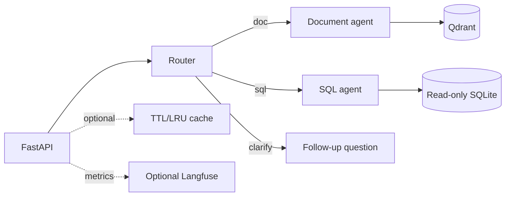

# Enterprise Knowledge Agent

Company policies, safe SQL answers, and focused follow-up questions—one LangGraph API.

[](https://github.com/RaafidAfraazG/Enterprise-Knowledge-Agent/actions/workflows/ci.yml)


## What it does

Routes company questions to policy documents, structured business data, or clarification.
Run locally with deterministic fake providers, or use Azure OpenAI and Qdrant Cloud.

| Question type | Example | Answer source |
| --- | --- | --- |
| Document | When does carried annual leave expire? | Policy docs via Qdrant |
| SQL | How many tickets have status closed? | Read-only SQLite |
| Unclear | What's the policy? | A follow-up question |

## See it in action

Start the service below and open `/docs` to try all three routes in the interactive API.
[Request and response examples](docs/CONFIGURATION.md#worked-examples) show the complete JSON shape.

## How it works



Explicit graph branches share provider interfaces, local request metrics, and optional caching and tracing.

## Highlights

- Multi-agent routing across document retrieval, SQL lookup, and clarification.
- Safe read-only SQL with parsing, a denylist, and bounded execution.
- A 200-question evaluation suite with accuracy regression gates.
- CI/CD to Azure Container Apps with credential-gated cloud stages.
- Optional Langfuse tracing, token accounting, and estimated request costs.
- Flag-controlled optimizations with a paired cold-cache benchmark.

## Quick start

Use Python 3.11 from the repository root; local fake mode needs no API keys or external services.
Install dependencies from your package index or cache, then run offline.

```bash
python3.11 -m venv .venv && source .venv/bin/activate
pip install -e ".[dev]"
pytest -q
LLM_PROVIDER=fake PROFILE=baseline QDRANT_URL= TRACING_ENABLED=false uvicorn kagent.api.main:app --host 127.0.0.1 --port 8000
```

In a second terminal:

```bash
curl -X POST http://127.0.0.1:8000/ask -H 'Content-Type: application/json' -d '{"question":"When does carried annual leave expire?"}'
```

Startup creates the demo database and ingests policy documents automatically when needed.

## Tech stack

`Python 3.11` · `LangGraph` · `LangChain` · `FastAPI` · `Azure OpenAI` · `Qdrant` · `SQLite` · `Langfuse` · `pytest` · `GitHub Actions`

## Results

<!-- RESULTS:START -->
Deployment-specific accuracy, p50/p95 latency, tokens, and estimated request costs are generated by the **Paired Azure benchmark** workflow and rendered here in its downloadable README artifact.
<!-- RESULTS:END -->

## Docs

- [Cloud setup and deployment](docs/SETUP.md)
- [Evaluation and benchmark methodology](docs/METHODOLOGY.md)
- [Configuration, API, development, and security reference](docs/CONFIGURATION.md)
