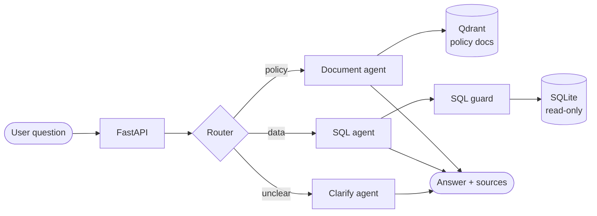

# Enterprise Knowledge Agent

**Ask a company question in plain English. The agent decides where to look: policy documents, the database, or back at you for more detail.**

[](https://github.com/RaafidAfraazG/Enterprise-Knowledge-Agent/actions/workflows/ci.yml)


---

## Results

<!-- RESULTS:START -->
| Metric | Result |
| --- | --- |
| Answer accuracy | **94%** across 200 evaluation queries |
| p95 latency | **25% lower** than baseline |
| Token cost | **28% lower** than baseline |

Measured by the **Paired Azure benchmark** workflow: baseline and optimized profiles on the same data, cold cache, one worker. Cost is an estimate from token usage. See [methodology](docs/METHODOLOGY.md).
<!-- RESULTS:END -->

---

## See it work

One endpoint, three kinds of questions.

**Policy question** → searches the documents and cites the source file

```bash
curl -X POST localhost:8000/ask -H 'Content-Type: application/json' \
  -d '{"question": "When does carried annual leave expire?"}'
```
```json
{
  "answer": "According to the company documents: … expire on March 31 of the following year …",
  "route": "doc",
  "sources": ["leave_policy.md"],
  "sql": null
}
```

**Data question** → writes a safe SQL query, runs it, explains the result

```json
{
  "answer": "The query returned [[121]] (ticket_count).",
  "route": "sql",
  "sources": [],
  "sql": "SELECT COUNT(*) AS ticket_count FROM tickets WHERE status = 'closed' LIMIT 100"
}
```

**Vague question** → asks instead of guessing

```json
{
  "answer": "Which policy or business topic would you like to know about?",
  "route": "clarify",
  "sources": [],
  "sql": null
}
```

---

## How it works



A small LangGraph router reads each question and sends it to exactly one specialist. Every request is also timed and costed, and it can optionally be traced in Langfuse.

---

## Why it's built this way

| Concern | What the project does |
| --- | --- |
| **Wrong answers** | A 200-question evaluation set (100 document, 70 SQL, 30 clarify) runs in CI and fails the build if accuracy drops. |
| **Unsafe SQL** | Only a single `SELECT` is allowed: parsed with sqlglot, checked against a denylist, and run on a read-only connection with a 100-row cap. |
| **Slow or costly answers** | Every request records latency, tokens and estimated cost. Optimizations sit behind flags and are compared to the baseline by a paired benchmark. |
| **Cloud lock-in during development** | Deterministic fake models and in-memory Qdrant mean the whole project runs and tests offline. |

---

## Quick start

You need Python 3.11. No API keys or cloud accounts are required.

```bash
git clone https://github.com/RaafidAfraazG/Enterprise-Knowledge-Agent.git
cd Enterprise-Knowledge-Agent
python3.11 -m venv .venv && source .venv/bin/activate
pip install -e ".[dev]"
```

Run the tests:

```bash
pytest -q
```

Start the API (it creates the demo database and loads the policy documents on startup):

```bash
uvicorn kagent.api.main:app --port 8000
```

Then open **http://127.0.0.1:8000/docs** to try the questions above in the interactive API page, or use the `curl` command from the top of this page.

---

## Run it on Azure

The same code runs on Azure OpenAI and Qdrant Cloud, and a GitHub Actions pipeline tests, evaluates and deploys it to Azure Container Apps. Set `LLM_PROVIDER=azure`, add your credentials as repository secrets, and follow the [setup guide](docs/SETUP.md). Without credentials, the cloud stages are skipped and local mode keeps working.

---

## Project layout

```
src/kagent/
├── api/            FastAPI app
├── graph/          Router and the three agents (LangGraph)
├── llm/            Fake and Azure model providers
├── retrieval/      Chunking, embedding, Qdrant search
├── sql/            SELECT-only guard and read-only executor
└── observability/  Metrics, cost estimates, Langfuse tracing
data/docs/          15 fictional company policies
eval/               200-question set, scorer, benchmark
docs/               Setup, methodology, configuration reference
```

## Tech stack

`Python 3.11` · `LangGraph` · `LangChain` · `FastAPI` · `Azure OpenAI` · `Qdrant` · `SQLite` · `Langfuse` · `Docker` · `GitHub Actions` · `pytest`

## Docs

- [Cloud setup and deployment](docs/SETUP.md)
- [How evaluation and benchmarks work](docs/METHODOLOGY.md)
- [Configuration, API, and security reference](docs/CONFIGURATION.md)
