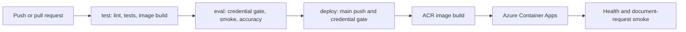
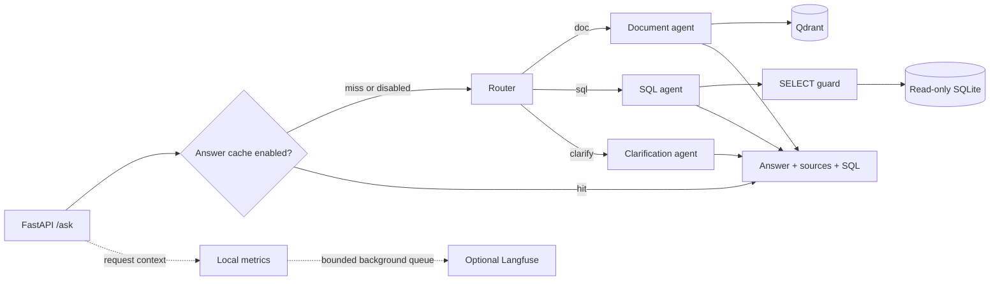

# Configuration and operations reference

Detailed runtime settings, API contracts, development workflows, and deployment controls for [Enterprise Knowledge Agent](../README.md).

## Runtime configuration

[`.env.example`](../.env.example) lists settings you can copy into an ignored `.env`. Process environment values override that file. Empty Azure settings are valid in fake mode; Azure mode needs an endpoint, key, both deployments, and a supported API version.

### LLM

| Variable | Default | Description |
| --- | --- | --- |
| `LLM_PROVIDER` | `fake` | `fake` or `azure` |
| `AZURE_OPENAI_ENDPOINT` | Empty | Azure OpenAI resource HTTPS endpoint |
| `AZURE_OPENAI_API_KEY` | Empty | Azure OpenAI secret key |
| `AZURE_OPENAI_CHAT_DEPLOYMENT` | Empty | Main chat deployment name |
| `AZURE_OPENAI_EMBED_DEPLOYMENT` | Empty | Embedding deployment name |
| `AZURE_OPENAI_API_VERSION` | `2024-02-01` | API version supported by the deployments |
| `AZURE_OPENAI_ROUTER_DEPLOYMENT` | Empty | Separate router deployment for `OPT_ROUTER_MODEL` |

### Qdrant

| Variable | Default | Description |
| --- | --- | --- |
| `QDRANT_URL` | Empty | Empty selects ephemeral in-memory Qdrant; otherwise the cluster URL |
| `QDRANT_API_KEY` | Empty | Remote cluster key |
| `QDRANT_COLLECTION` | `company_docs` | Collection name; Azure evaluation/benchmark requires an `eval_` prefix |
| `TOP_K` | `4` / `3` | Retrieved chunks: baseline / optimized defaults; explicit values override, range 1–20 |

### SQL

| Variable | Default | Description |
| --- | --- | --- |
| `SQLITE_PATH` | `data/company.db` | Read-only query database; generated on startup if missing |

### Profiles and optimizations

| Variable | Default | Description |
| --- | --- | --- |
| `PROFILE` | `baseline` | `baseline` or `optimized` |
| `OPT_ROUTER_MODEL` | Profile-dependent | Separate router deployment, shorter router prompt, and output cap |
| `OPT_CACHE` | Profile-dependent | Final-answer, query-embedding, and schema caches; errors/clarifications excluded |
| `OPT_PARALLEL` | Profile-dependent | Overlap query embedding with independent lexical preparation |
| `OPT_TOP_K` | Profile-dependent | Choose 3 rather than 4 chunks unless `TOP_K` is explicit |
| `OPT_SHORT_PROMPTS` | Profile-dependent | Shorter synthesis prompts and answer token caps |
| `CACHE_TTL_SECONDS` | `900` | Positive cache lifetime in seconds |
| `CACHE_MAX_SIZE` | `1000` | Declared capacity setting; runtime caches currently use fixed 1000-entry limits |

All `OPT_*` defaults are false for baseline and true for optimized. Each flag accepts an explicit environment override. Router-model selection has no effect without a router deployment. Cache state belongs to one graph/process; restart or clear it after changing data.

### Langfuse

| Variable | Default | Description |
| --- | --- | --- |
| `LANGFUSE_PUBLIC_KEY` | Empty | Langfuse project public key |
| `LANGFUSE_SECRET_KEY` | Empty | Langfuse project secret key |
| `LANGFUSE_HOST` | `https://cloud.langfuse.com` | Project host, including the appropriate region |
| `TRACING_ENABLED` | True if both keys exist | Enable export; missing either key always selects a no-op tracer |

### Pricing

| Variable | Default | Description |
| --- | --- | --- |
| `PRICE_CHAT_INPUT_PER_M` | Model price table | Override chat input USD per million tokens |
| `PRICE_CHAT_OUTPUT_PER_M` | Model price table | Override chat output USD per million tokens |
| `PRICE_EMBED_PER_M` | Model price table | Override embedding USD per million tokens |

Defaults come from [the pricing table](../src/kagent/observability/pricing.py). Unknown rates warn and use zero; that does not establish free usage. Cost is an estimate based on token usage and configured rates, excluding infrastructure and other charges.

### Evaluation and benchmark

| Variable | Default | Description |
| --- | --- | --- |
| `EVAL_MIN_ACCURACY` | `0.70` | Absolute answer-accuracy gate for the evaluation runner |
| `BENCH_LATENCY_N` | `100` | Deterministic sequential latency subset size |
| `BENCH_MAX_ACCURACY_DROP` | `0.02` | Maximum optimized accuracy loss as a fraction, equivalent to 2 percentage points |

## API reference

| Endpoint | Request | Response |
| --- | --- | --- |
| `GET /health` | None | `{"status":"ok"}` |
| `POST /ask` | `{"question":"…"}` | `answer`, `route`, `sources`, and nullable `sql` |
| `GET /docs` | Browser request | Interactive OpenAPI documentation |

Questions must be strings, nonblank, and at most 1000 characters. Validation failures return 422; internal failures or rejected SQL return 500 with `{"detail":"Unable to answer the question."}`.

Add `X-Debug-Metrics: 1` to `/ask` to include `metrics`: `latency_seconds`, `prompt_tokens`, `completion_tokens`, `total_tokens`, `estimated_cost_usd`, `per_node_latency`, and `cache_hit`. Ordinary responses omit this object. Azure usage comes from API responses; fake usage is deterministic and synthetic.

## Worked examples

These questions come from [the evaluation set](../eval/questions.jsonl). Examples use the default fake provider and deterministic demo data; the document answer is abridged, while its response fields and sources match the API.

### Document question → `doc`

**“When does carried annual leave expire?”** retrieves policy excerpts. The [leave policy](../data/docs/leave_policy.md) specifies March 31 of the following year.

```json
{
  "answer": "According to the company documents: … expire on March 31 of the following year …",
  "route": "doc",
  "sources": ["leave_policy.md"],
  "sql": null
}
```

### SQL question → `sql`

**“How many tickets have status closed?”** generates a SELECT, validates it, and explains its result. This response uses the count from the generated demo database.

```json
{
  "answer": "The query returned [[121]] (ticket_count).",
  "route": "sql",
  "sources": [],
  "sql": "SELECT COUNT(*) AS ticket_count FROM tickets WHERE status = 'closed' LIMIT 100"
}
```

### Ambiguous question → `clarify`

**“What's the policy?”** returns a follow-up without querying documents or SQL.

```json
{
  "answer": "Which policy or business topic would you like to know about?",
  "route": "clarify",
  "sources": [],
  "sql": null
}
```

## Local development setup

Use Python 3.11 and run from the repository root. Install dependencies once from your package index or local cache; fake-mode requests and the test suite then run offline without keys, Docker, or external services.

```bash
python3.11 -m venv .venv
source .venv/bin/activate
pip install -e ".[dev]"
pytest -q
ruff check .
LLM_PROVIDER=fake PROFILE=baseline QDRANT_URL= TRACING_ENABLED=false \
  uvicorn kagent.api.main:app --host 127.0.0.1 --port 8000
```

In a second terminal:

```bash
curl http://127.0.0.1:8000/health
curl -X POST http://127.0.0.1:8000/ask \
  -H 'Content-Type: application/json' \
  -d '{"question":"When does carried annual leave expire?"}'
```

Startup creates a missing `data/company.db` and ingests `data/docs/` into an empty collection. For a provisioned offline environment with dependencies and setuptools already installed, use `pip install --no-index --no-build-isolation -e ".[dev]"`. Fake answers echo retrieved excerpts or use SQL templates; they provide a reproducible development workflow.

## Development and data operations

Run checks from the repository root with the development environment activated:

```bash
pytest -q
ruff check .
python scripts/make_data.py
python scripts/build_eval_set.py
python scripts/ingest.py
```

The data command regenerates the four demo tables. The eval builder preserves the curated document/clarification seeds and recalculates SQL answers from the database. To extend the corpus, update those seeds and templates together with their validation tests.

Add markdown files to `data/docs/` and re-ingest. In-memory CLI collections last only for that process; restart the API to rebuild its instance. Remote ingestion replaces chunks for files present in the directory; removing a source entirely requires recreating the collection. Use a fresh collection when changing embedding dimensions.

Relative paths resolve from the repository root. Demo records are fictional and reproducible, and fake SQL uses a defined set of templates. Cloud smoke and benchmark workflows exercise external services; pytest blocks real network connections.

## Security

- `sqlglot` parsing and a keyword denylist enforce a single SELECT, including WITH queries; comments, writes, and multiple statements are rejected.
- The executor opens SQLite with `mode=ro`, enables query-only mode, applies an authorizer and instruction budget, and returns at most 100 rows.
- Supply secrets through environment configuration or an ignored `.env`; cloud runtime secrets use Container App secret references. Never commit credentials.
- The image runs as a non-root user. API failures return generic JSON without internal stack traces.
- Langfuse export is optional and best effort; traces include questions, context, SQL, and answers. Configure project access and data handling before using sensitive content.
- External ingress exposes the API without built-in authentication. Restrict access and use fictional data for the reference deployment.

## CI/CD and GitHub settings



[CI](../.github/workflows/ci.yml) runs tests and the Docker build without secrets. Cloud evaluation uses an isolated `eval_<run_id>` collection. Passing evaluation enables serialized deployment on pushes to `main`, with commit-SHA image tags and live API checks. Missing credentials skip cloud work with a notice and summary while the gate jobs finish successfully. The [manual benchmark workflow](../.github/workflows/benchmark.yml) independently compares profiles and uploads measured results.

Follow [SETUP.md](SETUP.md) for one-time Azure/Qdrant provisioning and the Cloud Shell bootstrap. Add these repository settings under **Settings → Secrets and variables → Actions**:

| Type | Name | Purpose |
| --- | --- | --- |
| Secret | `AZURE_OPENAI_API_KEY` | Azure chat and embedding access |
| Secret | `AZURE_OPENAI_ENDPOINT` | Azure OpenAI resource endpoint |
| Secret | `QDRANT_URL` | Qdrant Cloud cluster endpoint |
| Secret | `QDRANT_API_KEY` | Collection read/write access |
| Secret | `AZURE_CREDENTIALS` | RG-scoped service-principal JSON for deployment |
| Variable | `AZURE_OPENAI_CHAT_DEPLOYMENT` | Main chat deployment |
| Variable | `AZURE_OPENAI_EMBED_DEPLOYMENT` | Embedding deployment |
| Variable | `AZURE_OPENAI_API_VERSION` | API version; workflow default `2024-02-01` |
| Variable | `AZURE_RG` | Deployment resource group |
| Variable | `AZURE_ACR_NAME` | Container registry name |
| Variable | `AZURE_CONTAINERAPP_NAME` | Container App name |
| Variable | `APP_PROFILE` | Evaluation profile; bootstrap maps this to runtime `PROFILE` |
| Variable | `AZURE_OPENAI_ROUTER_DEPLOYMENT` | Optional router deployment |
| Secret | `LANGFUSE_PUBLIC_KEY`, `LANGFUSE_SECRET_KEY` | Optional tracing project keys |
| Variable | `LANGFUSE_HOST` | Optional tracing host |
| Variable | `EVAL_MIN_ACCURACY` | Evaluation accuracy threshold |
| Variable | `BENCH_LATENCY_N`, `BENCH_MAX_ACCURACY_DROP` | Benchmark sample and quality gate |
| Variable | `PRICE_CHAT_INPUT_PER_M`, `PRICE_CHAT_OUTPUT_PER_M`, `PRICE_EMBED_PER_M` | Optional benchmark price overrides |

Langfuse settings and price overrides are optional. Apply runtime configuration through bootstrap or Container App environment settings; repository variables alone do not rewrite the deployed app environment. The container serves on `PORT`, default 8000, with a `/health` check.

## Evaluation

The [200-question corpus](../eval/questions.jsonl) contains 100 document questions, 70 SQL questions, and 30 clarification questions. Document references use actual policy facts; SQL references are executed against the deterministic database. SQL scoring compares unordered result rows with duplicate preservation and absolute numeric tolerance `1e-6`; blocked or errored SQL is incorrect. Document scoring requires every case-insensitive fact anchor and, in Azure mode, an exact `CORRECT` verdict from the chat-model judge. Clarification scoring requires the `clarify` route and an answer ending in a question mark. Routing accuracy is reported separately.

```bash
python -m eval.run --provider fake --limit 20 --min-accuracy 0.0
python -m eval.benchmark --provider fake --limit 20
```

The first command is a functional check; the untuned fake model is not a cloud-quality benchmark. Real evaluation uses `EVAL_MIN_ACCURACY`; the paired benchmark fails if optimized accuracy drops beyond `BENCH_MAX_ACCURACY_DROP`.

## Performance and observability

Baseline retains the standard routing, prompts, and retrieval defaults. Optimized enables independently overridable flags. The benchmark ingests once, runs both profiles on the same data/collection, and measures a fixed subset sequentially after five excluded warm-up questions, clearing caches before each measured pass. Headline latency is the median of three cold-pass statistics; repeat-traffic cache hit rate and latency are a separate scenario. See [METHODOLOGY.md](METHODOLOGY.md) for scoring, pricing, and measurement limits.

Optional Langfuse tracing uses SDK 2.60.10 to export request traces, node/storage spans, and usage-aware generations. Export runs on a bounded background queue; errors are caught and logged, and shutdown/evaluation uses a bounded flush. With either key absent, tracing is a no-op. Local request metrics work independently of Langfuse.

### Benchmark result artifacts

Deployment-specific benchmark results are produced by **Actions → Paired Azure benchmark → Run workflow**. The workflow writes baseline and optimized accuracy, p50/p95/mean latency, tokens, estimated cost per request, and a separate repeat-traffic comparison to its result files. It also renders this section in the README included in the downloadable artifact.

The artifact contains `baseline.json`, `optimized.json`, `comparison.json`, `comparison.md`, and the rendered README. Download its JSON files into `eval/results/`, then run `python scripts/update_readme.py` to update this checkout. The renderer accepts complete Azure results, preserves the markers, and leaves the text unchanged for missing files or fake results.

## Architecture and components



| Module | Responsibility |
| --- | --- |
| `src/kagent/api/` | HTTP contracts, startup, and resource lifecycle |
| `src/kagent/graph/` | Routing, branch execution, state, and graph construction |
| `src/kagent/llm/` | Provider interfaces, deterministic fakes, and Azure adapters |
| `src/kagent/retrieval/` | Markdown ingestion, chunking, vector storage, and search |
| `src/kagent/sql/` | SELECT validation, schema inspection, and read-only execution |
| `src/kagent/cache.py` | In-process TTL/LRU caches |
| `src/kagent/observability/` | Request accounting, price estimates, tracing, and result formatting |
| `eval/` | Evaluation corpus, scoring, and paired benchmarks |

## Project structure

```text
.github/workflows/       # CI/CD and manual paired benchmark
src/kagent/
├── api/                 # FastAPI endpoints and lifespan
├── graph/               # State, nodes, and compiled workflow
├── llm/                 # Protocols, fakes, Azure providers, retries
├── retrieval/           # Chunking, ingestion, and Qdrant search
├── sql/                 # SELECT guard and read-only executor
├── observability/       # Metrics, pricing, tracing, result formatting
├── cache.py             # TTL/LRU cache implementation
├── config.py            # Environment-backed settings
└── data.py              # Deterministic SQLite generator
data/docs/               # 15 fictional company policy documents
eval/                    # Curated seeds, 200 questions, runners
scripts/                 # Data, ingestion, bootstrap, smoke, README tools
tests/                   # Offline unit and integration tests
docs/                    # Setup guide and benchmark methodology
Dockerfile               # Non-root Python 3.11 service image
pyproject.toml           # Package dependencies and development tools
.env.example             # Configuration reference
```

## Technology reference

| Layer | Technology |
| --- | --- |
| Runtime and packaging | Python 3.11, setuptools, src layout |
| Agent orchestration | LangGraph; LangChain dependencies |
| HTTP and configuration | FastAPI, Uvicorn, Pydantic Settings |
| Chat and embeddings | Deterministic fakes or Azure OpenAI via the OpenAI SDK |
| Knowledge stores | Qdrant vectors and SQLite business records |
| SQL validation | sqlglot, keyword denylist, SQLite authorizer |
| Observability | Context-local metrics; optional Langfuse SDK 2.60.10 |
| Quality tooling | pytest, Ruff, HTTPX, PyYAML |
| Delivery | GitHub Actions, Azure Container Registry, Azure Container Apps |

## Capabilities

Company knowledge spans policy documents and structured operational records, so answering a question starts with choosing the right source.
Enterprise Knowledge Agent routes each question to document retrieval, a read-only SQL lookup, or a focused clarification.
A FastAPI service exposes the graph with source filenames and the SQL used to produce an answer.
Deterministic fake providers and fictional company data make local development and testing possible without cloud services or API keys.
Azure OpenAI, Qdrant Cloud, optional Langfuse tracing, and reproducible evaluation workflows support cloud deployments using the same interfaces.

- **Multi-agent routing:** explicit document, SQL, and clarification branches in LangGraph.
- **Document RAG:** markdown chunking, embeddings, Qdrant search, and source attribution.
- **Safe SQL:** SELECT-only validation, bounded results, and read-only SQLite execution.
- **Clarification:** one short follow-up for underspecified questions.
- **FastAPI service:** validated requests, health checks, and optional debug metrics.
- **Evaluation suite:** 200 questions, route-specific scoring, and accuracy regression gates.
- **Azure CI/CD:** credential-gated evaluation and deployment to Azure Container Apps.
- **Optional Langfuse tracing:** request traces, node spans, and usage-aware generations.
- **Independent request metrics:** latency, token usage, cache hits, and estimated cost.
- **Flag-controlled optimizations:** routing model, caches, parallel preparation, top-k, and prompts.
- **Benchmark harness:** paired profiles with cold-work and repeat-traffic scenarios reported separately.

## Roadmap

- Hybrid lexical/vector retrieval with metadata filtering.
- Reranking and broader, independently reviewed evaluation datasets.
- Authentication, tenant-aware authorization, and document-level access policies.
- Streaming responses with incremental source attribution.
